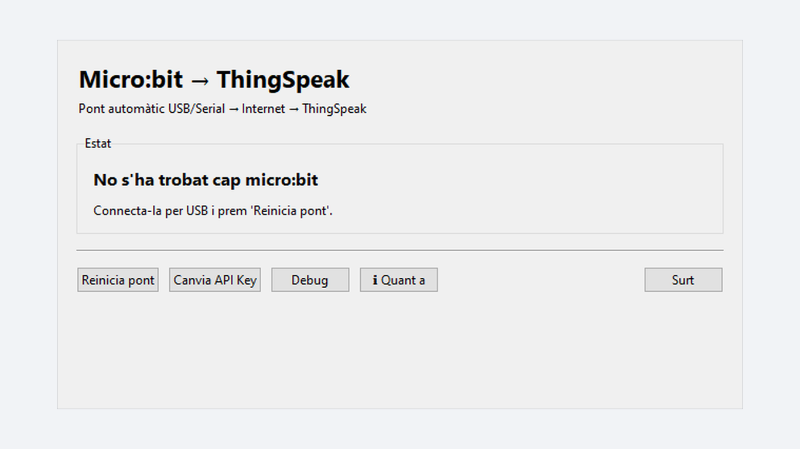
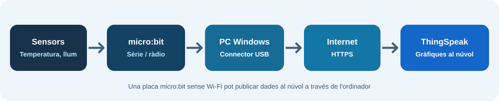

# Connector micro:bit → ThingSpeak

Aplicació Windows que connecta una BBC micro:bit per USB/sèrie amb ThingSpeak. Detecta automàticament el port, desa la Write API Key localment, envia fins a vuit camps de sensors i mostra l'estat i els detalls de la comunicació.

> **Estat del codi:** reconstrucció funcional de la versió 5.1.4 a partir del bytecode CPython 3.12 de l'EXE original. El fitxer Python original no s'ha recuperat literalment i el binari resultant no es considera idèntic al distribuït. Vegeu [la traçabilitat tècnica](docs/RECONSTRUCCIO.md).

## Nova funció en prova · v5.1.5

Mentre la micro:bit és connectada per USB, el connector impedeix que Windows
entri en suspensió automàtica. **La pantalla es pot apagar** amb el temps normal
configurat a Windows.

- Win32 `SetThreadExecutionState(ES_CONTINUOUS | ES_SYSTEM_REQUIRED)`,
  sense `ES_DISPLAY_REQUIRED`.
- Es restaura l'estat d'energia quan es desconnecta o s'atura el pont.
- El botó **Debug** permet comprovar si la protecció està activa.
- No evita la suspensió manual, el tancament de tapa, les polítiques del centre
  ni els apagats per bateria baixa.

**És una compilació de prova sense signar** feta a partir de la reconstrucció
funcional de la 5.1.4, no una actualització de Microsoft Store. Cal fer la prova
física abans de redistribuir-la.

## Funcionalitat

- Connexió automàtica al port USB/COM de la micro:bit, a 115200 bauds.
- Enviament HTTPS a l'API de ThingSpeak amb un interval mínim de 15 segons.
- Missatges separats per comes: **23,157,623** envia tres camps. **HORT,23,157,623** ignora l'etiqueta inicial i envia també tres camps.
- Configuració a AppData amb compatibilitat amb fitxer portable i amb configuracions antigues.
- Botons **Reinicia pont**, **Canvia API Key**, **Debug**, **Quant a** i **Surt**.

**Important:** no és una connexió Wi-Fi directa de la micro:bit. La placa es connecta per USB a Windows, i l'ordinador envia els valors a Internet.

## Instal·lació i ús

1. Crea un canal a [ThingSpeak](https://thingspeak.mathworks.com/) i activa els camps necessaris.
2. Copia la **Write API Key** del canal, no la Read API Key.
3. Programa la micro:bit amb els exemples de la carpeta [examples](examples/). Pots connectar la placa receptora per USB, i una emissora per ràdio.
4. Executa l'aplicació. La primera vegada et demanarà la Write API Key.
5. Obre el canal ThingSpeak i comprova les entrades. Per als diagnòstics, prem **Debug**.

Consulta la [Guia d'ús pas a pas](docs/GUIA_US.md), la [Presentació d'ús](docs/PRESENTACIO_US.md) i la [presentació PowerPoint editable (8 diapositives)](docs/Presentacio_us_Connector_microbit_ThingSpeak.pptx).

## Executar des dels fonts

Requereix Windows 10/11 i Python 3.12.

~~~powershell
py -3.12 -m venv .venv
.\.venv\Scripts\python -m pip install -r requirements.txt
.\.venv\Scripts\python microbit_thingspeak_gateway.py
~~~

Per construir un EXE independent:

~~~cmd
build_windows.bat
~~~

La compilació es documenta a [Compilació](docs/COMPILACIO.md). El flux de GitHub Actions genera un EXE **sense signar**; per a SignPath cal una revisió pròpia i construir des d'un commit públic verificat.

## Privacitat

La Write API Key s'emmagatzema en un fitxer JSON **sense xifrar** dins de:

~~~text
%APPDATA%\Microbit-ThingSpeak-Gateway\config.json
~~~

No comparteixis aquest fitxer, no el pugis a GitHub i regenera la clau si ha estat divulgada. El programa només envia les dades al servidor oficial https://api.thingspeak.com/update.json.

## Continguts

| Element | Propòsit |
| --- | --- |
| microbit_thingspeak_gateway.py | Aplicació reconstruïda a partir de la 5.1.4 |
| examples/ | MicroPython per a emissora i receptora |
| docs/GUIA_US.md | Manual detallat per a l'aula |
| docs/PRESENTACIO_US.md | Guió de presentació i demostració |
| docs/arquitectura.svg | Diagrama del flux de sensors |
| docs/RECONSTRUCCIO.md | Procedència i límits de la reconstrucció |
| tests/ | Proves automatitzades sense maquinari |
| .github/workflows/build-windows.yml | Compilació Windows sense signatura |

## Llicència i reconeixements

- **Codi:** EUPL 1.2, d'acord amb la informació que apareix a l'EXE original. Text oficial a [LICENSE](LICENSE).
- **Desenvolupament indicat a l'EXE:** Ignasi Sánchez Rodríguez, projecte Estació Meteorològica en Xarxa, programa Mentoria 4.0.
- **Copyright indicat a l'EXE:** © 2026 Generalitat de Catalunya · Departament d’Educació i Formació Professional.
- Els materials educatius històrics indiquen **CC BY-NC-SA 4.0**.
- Aquest connector és un projecte independent, sense afiliació ni aval de la Micro:bit Educational Foundation, MathWorks o Microsoft.
- El logotip institucional incrustat al binari històric no es publica en aquest repositori. S'hi utilitza una icona alternativa pròpia.

El repositori **no garanteix equivalència binària ni verificació amb maquinari real**. Cal validar qualsevol nova versió abans de redistribuir-la. Consultes i contribucions: [CONTRIBUTING.md](CONTRIBUTING.md) i [SECURITY.md](SECURITY.md).
