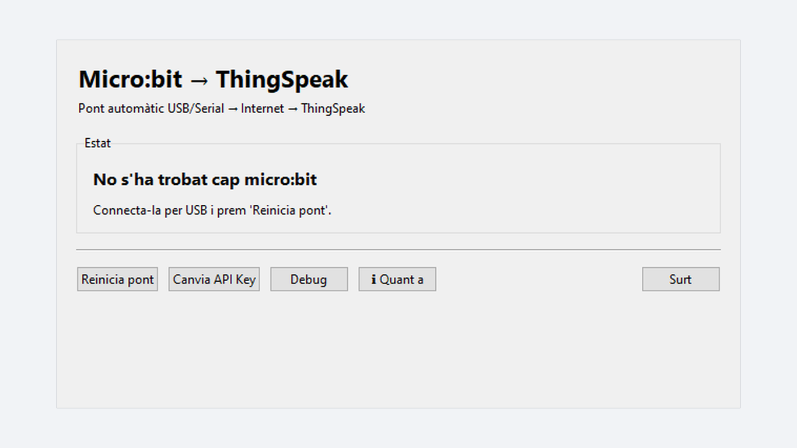

# Guia d'ús — Connector micro:bit → ThingSpeak

**Destinataris:** docents i alumnat de projectes de ciències, tecnologia, meteorologia i IoT.

## 1. Materials

Ordinador Windows 10/11 amb Internet, cable USB de dades, una o dues plaques BBC micro:bit i un compte ThingSpeak. Els sensors poden ser interns (temperatura i llum) o externs (entrada analògica P0).

## 2. Prepara ThingSpeak

1. A https://thingspeak.mathworks.com crea un canal nou.
2. Activa almenys el camp **Field 1**; per a l'exemple, posa-hi temperatura.
3. Activa **Field 2** (llum) i **Field 3** (sensor analògic).
4. Desa i copia la **Write API Key** de la secció API Keys. Mantén-la privada.

## 3. Programa les plaques

Els exemples MicroPython són a la carpeta [examples](../examples/).

Amb dues plaques: una executa **microbit_emissor_exemple.py**, que envia tres mesures per ràdio, i l'altra **microbit_receptor.py**, que les mostra per USB. Totes dues comparteixen **radio group 23**. Connecta la receptora al PC mitjançant un cable USB de dades.

Amb una sola placa: programa-la perquè escrigui amb print() una línia de valors separats per comes per USB, a **115200 bauds**. No és necessari utilitzar ràdio.

## 4. Obre el connector

1. Executa el programa. La primera vegada, enganxa la clau d'escriptura del canal.
2. Espera que aparegui l'estat de connexió. Si no troba la placa, comprova el cable i prem **Reinicia pont**.
3. En rebre mesures i enviar-les, l'aplicació mostra el darrer valor i l'identificador d'entrada.
4. Ves a ThingSpeak → **Private View** i observa l'evolució del gràfic.

## 5. Els botons

| Botó | Ús |
| --- | --- |
| Reinicia pont | Torna a detectar el port USB |
| Canvia API Key | Canvia de canal ThingSpeak |
| Debug | Consulta el port, la darrera línia i la resposta del servidor |
| Quant a | Consulta la versió, autoria i llicència |
| Surt | Tanca el connector i allibera el port |

## 6. Format de dades

~~~text
23,157,623
HORT,23,157,623
~~~

La primera línia envia els camps 1, 2 i 3. A la segona, el connector elimina l'etiqueta textual HORT. Accepta fins a vuit valors. Les mesures s'han d'enviar numèricament des de MicroPython.

El connector només envia com a màxim una actualització correctament acceptada cada **15 segons**.

## 7. Resolució de problemes

| Problema | Què fer |
| --- | --- |
| No troba la micro:bit | Canvia el cable USB, prova un altre port i tanca editors oberts |
| Port COM ocupat | Tanca MakeCode, Mu i terminals sèrie |
| No hi ha valors | Revisa el codi, el grup ràdio i el format CSV |
| ThingSpeak rebutja | Revisa la Write API Key, els camps i l'interval |
| Sense Internet | Comprova connexió HTTPS des del PC |

## 8. Seguretat i bones pràctiques

La Write API Key es conserva localment en un fitxer JSON sense xifrar. No la mostris a l'alumnat ni en captures de pantalla. Si es filtra, regenera-la a ThingSpeak. No recullis dades personals de menors sense les autoritzacions pertinents.

## 9. Activitat d'aula (45–60 minuts)

- 10 min: crear el canal i identificar les magnituds.
- 10 min: programar micro:bits.
- 10 min: obrir el connector i comprovar dades.
- 15 min: variar la llum o temperatura i observar el gràfic.
- 5–15 min: debat sobre intervals, errors de mesura i interpretació de dades.

**Resultat:** una sèrie temporal al núvol i una explicació del flux de dades.
