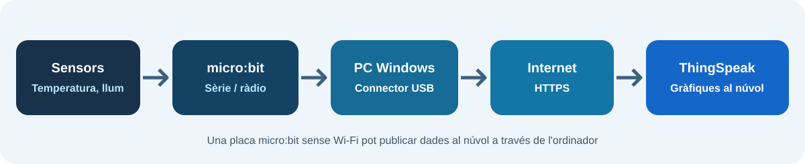
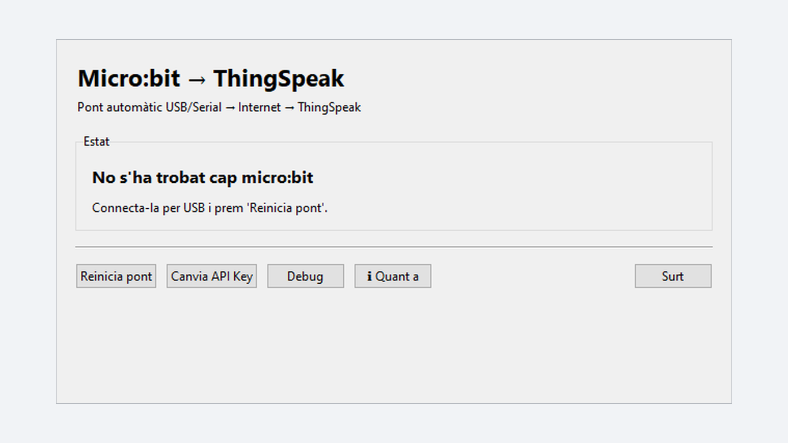

# Presentació d'ús — Del sensor al núvol

**Durada:** 10–15 minuts. **Públic:** equips docents i alumnat. Aquest document es pot utilitzar com a guió de diapositives o demostració.

## 1. Què és?

El Connector micro:bit → ThingSpeak és un pont entre dades de sensors i una plataforma de gràfics al núvol.

**Demostració:** obrir la finestra real de l'aplicació.

## 2. El flux de dades

Sensor → micro:bit emissora → (ràdio opcional) → micro:bit receptora → USB → PC → HTTPS → ThingSpeak.

## 3. Què necessitem?

Plaques micro:bit, cable USB de dades, PC Windows, Internet i canal ThingSpeak.

**Pregunta:** quina part fa servir Internet?

## 4. Primera configuració

Activa els camps del canal i copia la **Write API Key**. No la mostris mai en públic.

## 5. Format de les mesures

Exemple **23,157,623**. També s'accepta una etiqueta inicial: **HORT,23,157,623**.

**Repte:** transmetre un quart sensor.

## 6. Coneixem els controls

**Reinicia pont**, **Canvia API Key**, **Debug**, **Quant a** i **Surt**.

## 7. Observem les dades

Obre el canal ThingSpeak, comprova els gràfics i experimenta canviant la temperatura o la llum. L'interval mínim és de 15 segons.

## 8. Aplicacions educatives

- Estació meteorològica al pati.
- Hort escolar: temperatura i humitat de terra.
- Comparació de condicions ambientals entre aules.
- Xarxa de centres amb dades comunes i un protocol compartit.

**Pregunta final:** com ens ajuda un gràfic a prendre decisions?

---

Per ampliar els passos: [guia d'ús](GUIA_US.md). L'ús de ThingSpeak i micro:bit no implica cap relació oficial amb els titulars de les marques.
